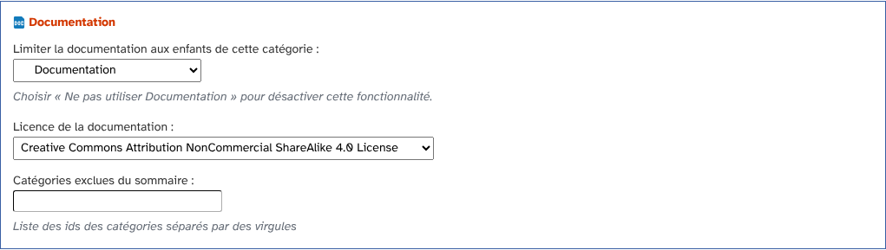
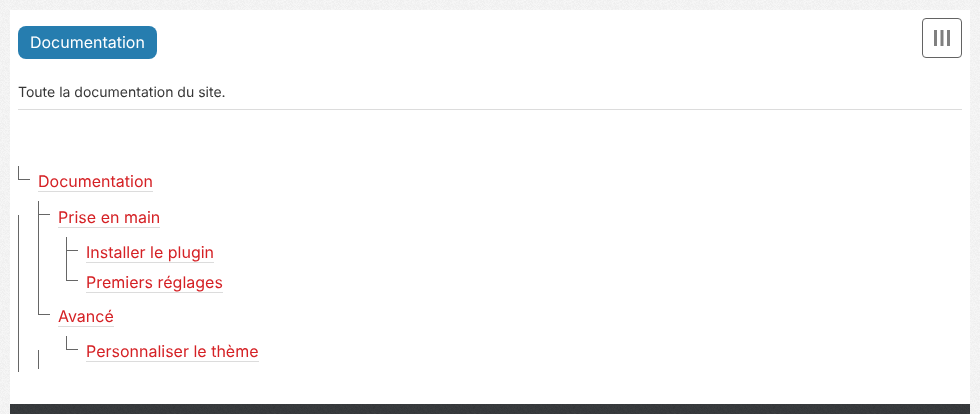
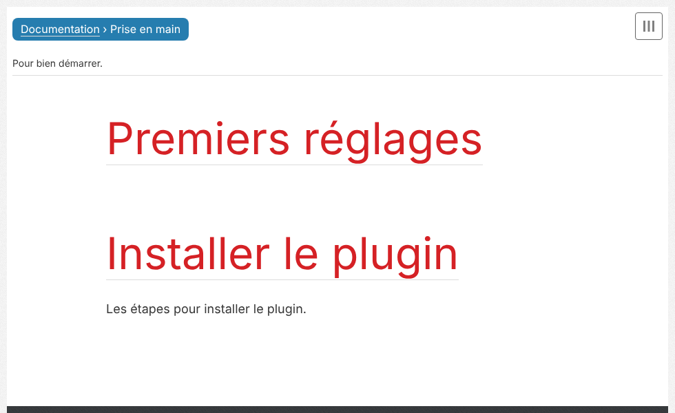
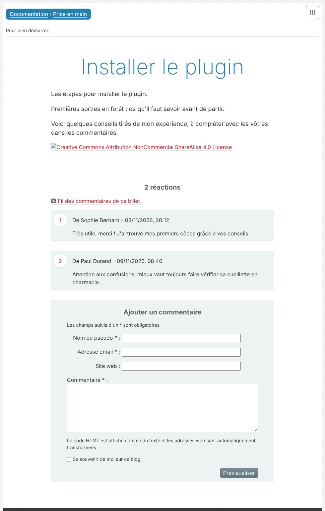
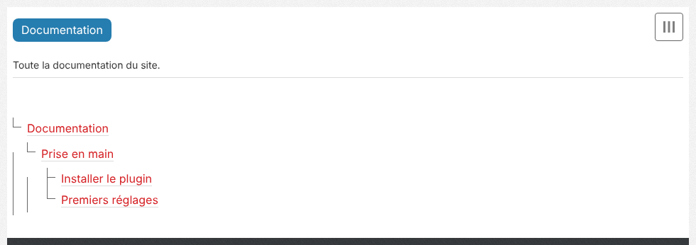

# Documentation : guide d'utilisation

Documentation sert à publier une documentation sur votre blog. Vous choisissez une catégorie « racine » : toutes ses sous-catégories et leurs billets sont alors affichés avec des modèles spéciaux. La catégorie racine affiche un sommaire complet, les sous-catégories listent leurs billets, et chaque billet est présenté comme une page de documentation.

Ce plugin n'a pas de page d'administration : tout se règle dans les paramètres du blog.

## Sommaire

1. [Ce qu'il faut avant de commencer](#ce-quil-faut-avant-de-commencer)
2. [Préparer les catégories](#préparer-les-catégories)
3. [Régler le plugin](#régler-le-plugin)
4. [Ce que voient les visiteurs](#ce-que-voient-les-visiteurs)
5. [Exclure des catégories du sommaire](#exclure-des-catégories-du-sommaire)
6. [Mettre un billet en avant](#mettre-un-billet-en-avant)
7. [Les balises pour vos modèles](#les-balises-pour-vos-modèles)
8. [Bon à savoir](#bon-à-savoir)

## Ce qu'il faut avant de commencer

Le plugin fonctionne avec tous les thèmes : ses pages utilisent toujours ses propres gabarits et sa feuille de style.

## Préparer les catégories

Dans **Blog > Catégories**, créez une catégorie pour la documentation, par exemple **Documentation**. Ajoutez-y des sous-catégories, par exemple **Prise en main** et **Avancé**, puis rangez vos billets dedans.

Donnez une description à chaque catégorie : elle est affichée en haut des pages.

## Régler le plugin

Allez dans **Blog > Paramètres du blog**, puis ouvrez la section **Paramètres des plugins pour ce blog**. Le bloc **Documentation** propose trois réglages :

* **Limiter la documentation aux enfants de cette catégorie** : choisissez la catégorie racine, ici **Documentation**. Laissez **Ne pas utiliser Documentation** pour désactiver le plugin.
* **Licence de la documentation** : la licence Creative Commons affichée en bas des billets, par défaut BY-NC-SA 4.0. Six licences sont proposées.
* **Catégories exclues du sommaire** : voir [plus bas](#exclure-des-catégories-du-sommaire).

Enregistrez les paramètres du blog.

## Ce que voient les visiteurs

Seules la catégorie racine, ses sous-catégories et leurs billets changent. Le reste du blog garde ses modèles habituels.

### La catégorie racine : le sommaire

La page de la catégorie racine affiche son titre, sa description, puis un sommaire en arbre : toutes les sous-catégories et, dessous, les titres de leurs billets. Les sous-catégories vides sont aussi affichées.

### Une sous-catégorie

Une sous-catégorie affiche son titre avec le chemin des catégories parentes, sa description, puis ses billets : le titre et l'extrait de chacun.

Une sous-catégorie qui ne contient pas de billet liste ses propres sous-catégories.

### Un billet

Un billet de documentation est présenté sans navigation « billet précédent / suivant », avec le chemin de sa catégorie en haut de page.

## Exclure des catégories du sommaire

Dans **Catégories exclues du sommaire**, écrivez les numéros (ids) des catégories à cacher, séparés par des virgules, par exemple `6` ou `6,7`. Le numéro d'une catégorie se voit dans l'adresse de son édition, dans l'administration. Seuls les numéros sont gardés à l'enregistrement : le reste est ignoré.

L'exclusion ne cache la catégorie que dans le sommaire de la catégorie racine. Sa page reste accessible si on connaît l'adresse, et ses billets restent publiés.

## Mettre un billet en avant

Dans une sous-catégorie, les billets **sélectionnés** passent avant les autres. Cochez la case des billets sélectionnés dans le panneau latéral de l'édition du billet pour le placer en tête de sa catégorie.

## Les balises pour vos modèles

Si vous écrivez vos propres modèles, le plugin ajoute :

* `{{tpl:DocumentationCategoriesList}}` : le sommaire en arbre. Options : `with_empty="1"` pour afficher les catégories vides, `with_posts="1"` pour lister les billets.
* `{{tpl:DocumentationLicenseBadge}}` : le badge de licence Creative Commons.
* `<tpl:DocumentationIf>` : condition, avec `has_root_cat="1"` (une catégorie racine est choisie) et `is_root_cat="1"` (la catégorie affichée est la racine), et l'option `operator`.

## Bon à savoir

* **Le badge de licence** s'affiche en bas de chaque billet de documentation, avec un lien vers la licence choisie sur le site de Creative Commons.
* **Les libellés des licences** sont en anglais dans la liste des réglages.
